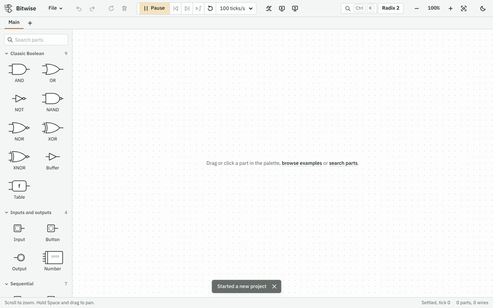
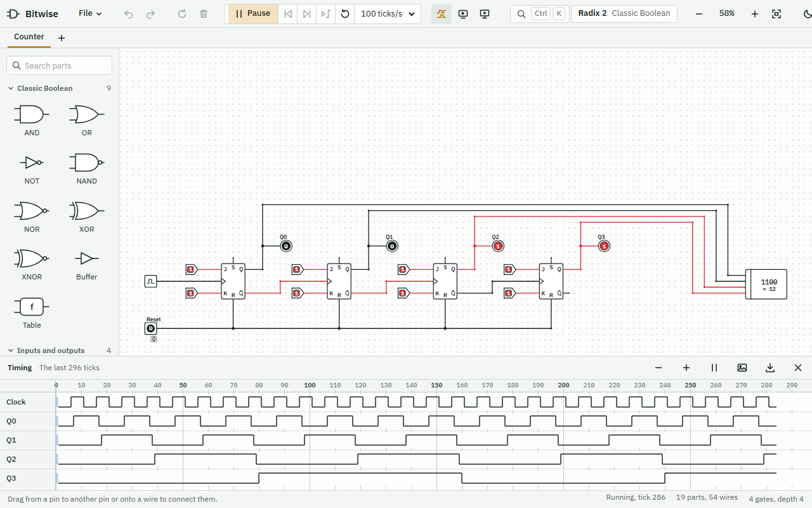
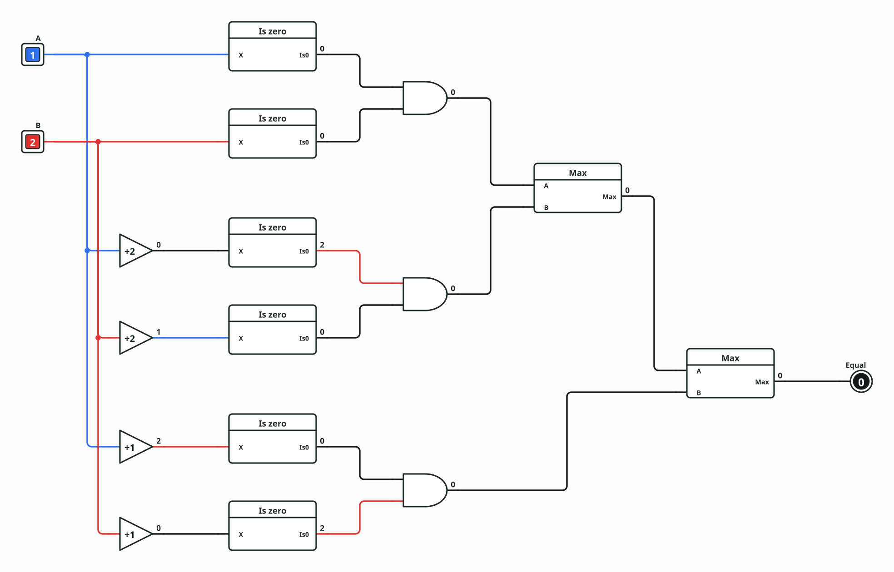
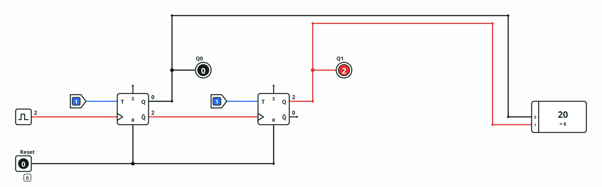
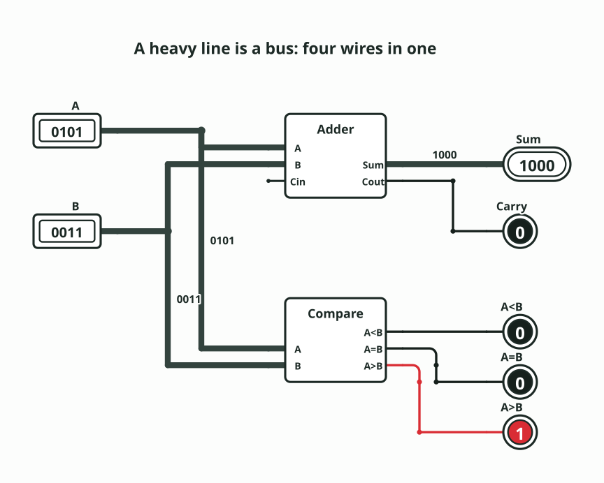
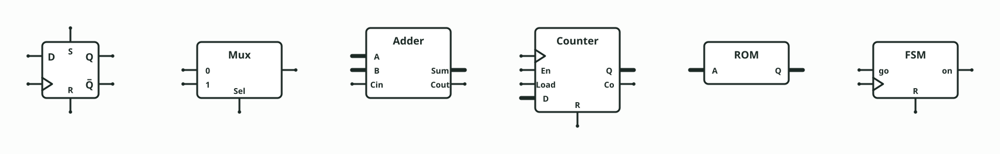
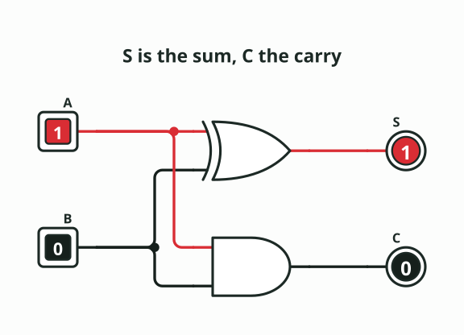

# Bitwise

A digital logic simulator that runs in the browser, inspired by
[CedarLogic](https://github.com/CedarvilleCS/CedarLogic): build a circuit from
gates and watch it simulate as you wire it. A wire is not limited to two
values: pick a radix n from 2 to 16 and every wire carries a digit from 0 to
n-1.

**Open it in the browser:** <https://tamirgabgab.github.io/bitwise/>.
Nothing to install; projects are kept in your browser. It also installs as
an app and works without a network, and the interface speaks English or
Hebrew.

<p align="center">
  
</p>

<p align="center">
  
</p>

## A few circuits

Every picture here is drawn by the simulator itself, with the values the
circuit carries. All of them are among the ready-made examples in the File
menu, so you can open each one and change it.

### Three values on a wire

At radix 3 a wire carries 0, 1 or 2, each in its own color. This circuit
builds Max, Is zero and Equal from NOT, AND and Shift, with A at 1 and B at 2.

<p align="center">
  
</p>

### A counter that counts in threes

A T flip-flop adds its input modulo n, so at radix 3 each one is a whole
ternary digit. Two of them and a clock count from 0 to 8.

<p align="center">
  
</p>

### Buses

Give a part a width and its wires become a bus, drawn heavy with the value
written beside it. Here 0101 and 0011 go into an adder and a comparator.

<p align="center">
  
</p>

### Larger parts

Flip-flops, a multiplexer, an adder, a counter, a ROM and a state machine
with an editor of its own, next to many more in the palette. All of them
work at any radix.

<p align="center">
  
</p>

## A half adder

<p align="center">
  
</p>

## What works today


- **Circuit editor.** Drag gates onto a canvas, wire them, move, rotate,
  delete, undo and redo, copy and paste, pan and zoom. Light and dark themes.
- **Live simulation.** Switches, push buttons and outputs, wires colored by
  the value they carry, and Run, Pause, Step and Restart with a speed
  setting. The circuit keeps running while you edit it.
- **n-valued logic.** AND is the minimum, OR the maximum, NOT the mirror
  (n-1)-x, and Shift adds a constant modulo n (at radix 2 it is NOT). You
  choose the kit of universal gates to build with: NAND, NOR (Webb),
  Post (Shift + AND), Kleene + Shift, detectors, or field arithmetic when n
  is prime. At radix 2 every kit behaves exactly like Boolean logic.
- **Named circuits.** A project holds several circuits in tabs. Any circuit
  can be used as a part of another: its switches become input pins and its
  outputs output pins. A change to a circuit shows everywhere it is used.
- **Clocks and memory.** A clock, an SR latch and D, T and JK flip-flops
  with Set and Reset, all defined for any radix: a T flip-flop adds its
  input modulo n, so it is one digit of a counter. A number display shows
  several wires as one number.
- **Timing diagram.** A panel under the canvas follows the clocks, switches
  and outputs over the last ticks, and any wire you right-click. Zoom in
  time, freeze the view while the circuit runs on, and point at a tick to
  read every row. A step button runs to the next clock edge, and a circuit
  that oscillates without a clock is pointed out.
- **Saving.** The browser keeps a list of projects as you work: switch
  between them, rename, copy or delete. A project can be saved to and opened
  from a JSON file. Six ready-made examples are in the File menu, two of
  them on buses, and each opens as a project of its own.
- **Finding out what a circuit does.** Point at a wire to see its value and
  what drives it, pause the run when a wire takes a chosen value, step one
  tick back, and read the gate count and the longest delay in the status
  bar; click the delay to see that path on the canvas. The inspector shows
  what every pin of a part carries and what a memory part keeps. A switch
  can have a keyboard key.
- **More parts for n-valued logic.** A switch that cycles through every
  value, converters between one digit and several bits, and the table of
  any gate at the current radix when you point at it in the palette.
- **Buses and larger parts.** Give any part a width and its wires become a
  bus, drawn heavy with the value beside it. A splitter and a merger go
  between a bus and its digits, and a multiplexer, demultiplexer, decoder,
  adder, comparator, register and counter work on whole buses at any radix.
- **Editing help.** Align and spread parts, copy by dragging with Alt, turn
  a selection into a named circuit, and write notes on the canvas. Wires
  find their way around parts, and a selected wire can be dragged aside.
  The slash key adds a part where the pointer is.
- **Showing a circuit.** Save a list of steps, each with switch values and
  a note, and walk through them with the arrow keys. Export the drawing as
  SVG.
- **Finding your way.** Ctrl+K searches every action, part and example,
  and "?" lists the keyboard shortcuts. The palette has a search field and
  sections that fold. A first visit starts with a short tour, an overview
  map appears when the drawing runs off screen, and a wire shows a brief
  wave when its value changes.
- **Memory and state machines.** A ROM and a RAM of up to 256 words, typed
  or pasted in the inspector. A state machine is drawn as states and arrows
  in a window of its own, runs as one part, and can be built from D
  flip-flops and minimized gates as a new circuit.
- **Simulation core.** Unknown (X) and floating (Z) values next to the
  digits, driver conflicts, and an event-driven engine with per-component
  delays.
- **Verilog.** Export a circuit as Verilog, and build circuits from
  Verilog modules: gates, `assign` with operators, and `always` blocks that
  become flip-flops, registers and multiplexers. Radix 2 only.
- **Sharing.** A link that carries the whole project, a timing diagram
  exported as SVG or VCD, and expressions and Karnaugh maps both ways.
- **Anywhere.** Pinch to zoom and drag with a finger on a phone, install
  the site as an app that opens without a network, or run the desktop app.
  The interface speaks English or Hebrew, right to left.

## Install

- **As an app from the browser.** Open the site and choose "Install" in the
  browser's menu (in Chrome and Edge also the icon in the address bar; on an
  iPhone, Share > Add to Home Screen). It then opens in a window of its own
  and works without a network. A new release arrives on its own; a message
  offers to reload when one is ready.
- **The desktop app.** Installers for Windows, macOS and Linux are attached
  to the [releases](https://github.com/tamirgabgab/bitwise/releases). It
  saves projects as `.bitwise` files, and a double click on one opens it.
  The installers are not signed, so Windows and macOS ask before the first
  start.

See [docs/PLAN.md](docs/PLAN.md) for the roadmap and
[docs/n_ary_logic_sim_spec.md](docs/n_ary_logic_sim_spec.md) (in Hebrew) for
the mathematics behind the gate kits.

## Development

Requires Node.js 24 or newer.

```bash
npm install
npm run dev
```

Then open the address the dev server prints, usually
<http://localhost:5173/>.

| Command | What it does |
| --- | --- |
| `npm run dev` | Start the dev server |
| `npm test` | Run the unit tests |
| `npm run lint` | Lint with oxlint |
| `npm run build` | Type-check and build to `dist/` |
| `npm run pictures` | Draw the circuit pictures of this page again |
| `npm run build:e2e` | Build the site for the end-to-end tests, to `dist-e2e/` |
| `npm run e2e` | Run the end-to-end tests in Chromium (desktop and phone) |
| `npm run site-pictures` | Draw the icons, the share picture, the screenshot and the film (needs `build:e2e` and ffmpeg) |
| `npm run tauri build` | Build the desktop app (needs Rust; CI builds it otherwise) |

The end-to-end tests need a browser once: `npx playwright install chromium`.

## Publishing

Every push to `main` that passes lint, tests, build and the end-to-end
tests is published to GitHub Pages by `.github/workflows/pages.yml`. Pages
has to be switched on once in the repository settings: Settings > Pages >
Source: GitHub Actions.

The desktop app is built by `.github/workflows/desktop.yml` on every push
to `main`. A tag such as `v0.2.0` also makes a draft release with the
installers; publish it by hand.

## License

[MIT](LICENSE)
